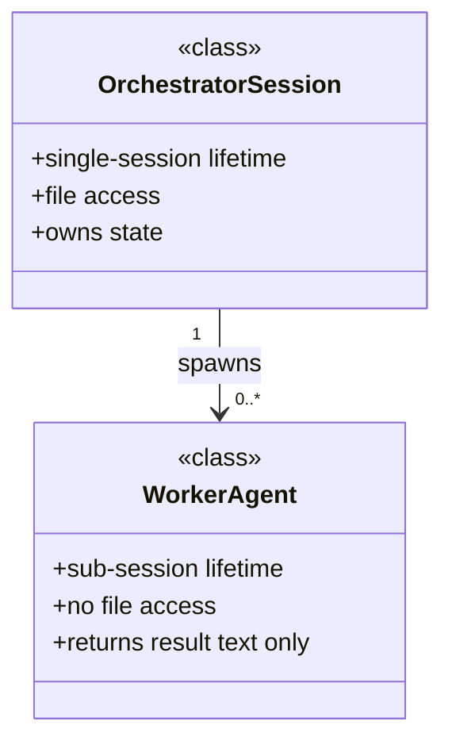

# Design Document Standards

**Scope:** All documents in `docs/design/` and `docs/sw-design/`. Applies to any document that defines entities, relationships, or architectural patterns — regardless of lifecycle label (living, exploration, spec).

**Enforcement:** Referenced by CLAUDE.md. Required in Plan subagent prompts for design tasks. Required in Proposer worker task prompts (golem-review Step 4c) when proposing changes to architecture documents.

---

## Rule 1: Name the Software Design Patterns

Every design document must explicitly name the software design patterns it instantiates. Patterns may come from any established catalog — GoF, POSA, Policy-Based Design, Enterprise Integration Patterns, DDD, cloud/architectural patterns, or domain-specific catalogs.

**Format:** `**Pattern: [Name]** — [one sentence on how it applies here]`

**Pattern vocabulary (non-exhaustive):**

| Catalog | Patterns |
|---|---|
| GoF Structural | Facade, Adapter, Decorator, Composite, Proxy, Bridge, Flyweight |
| GoF Behavioral | Strategy, Command, Chain of Responsibility, Template Method, Observer, Iterator, Mediator, State, Visitor |
| GoF Creational | Factory, Abstract Factory, Builder, Singleton, Prototype |
| Architectural | Orchestrator-Worker, HITL Gate, Generator-Critic Loop, Fan-in/Fan-out, Pipeline, Event-Driven, CQRS, Pub-Sub, Layered, Microkernel, Blackboard |
| Policy-Based Design | Policy, Rule Engine, Guard Clause, Specification |
| Enterprise Integration (EIP) | Saga, Outbox, Request-Reply, Dead Letter, Correlation ID |
| Domain-Driven Design | Aggregate, Repository, Domain Event, Anti-Corruption Layer, Bounded Context |
| Cloud / Distributed | Circuit Breaker, Retry with Backoff, Bulkhead, Sidecar, Ambassador |

If no established pattern fits: state "custom pattern" and describe it in one sentence. Do not omit this section — a design without a pattern name is under-specified.

**Example:**
```
**Pattern: Chain of Responsibility** — each entity in the Critic→Proposer→Human sequence
can absorb, transform, or pass findings forward; no entity requires another to act.

**Pattern: Command** — HITL decisions (APPLY-NOW, QUEUE, REJECT) are command objects with
known executors; the Orchestrator is the invoker; persistent documents are the receivers.
```

---

## Rule 2: Include Mermaid ER Diagrams

Every design document must include at least one Mermaid diagram showing entity relationships. Every entity defined in the document must appear in at least one diagram.

**Required diagram types (use as appropriate):**

| Diagram type | Use for |
|---|---|
| `classDiagram` | Entity models, class hierarchies, composition relationships |
| `sequenceDiagram` | Interaction flows, message passing, temporal order |
| `flowchart` | Decision flows, state machines, conditional paths |

**Minimum requirement:** one `classDiagram` showing all entity types and their relationships.

**Example:**


---

## Rule 3: Annotate All Relationships with Cardinality

Every relationship in both diagrams and tables must show explicit cardinality.

**Standard notation:**

| Symbol | Meaning |
|---|---|
| `1` | Exactly one |
| `0..1` | Zero or one |
| `1..*` | One or more |
| `0..*` | Zero or more |
| `N..M` | Bounded range |

**In Mermaid `classDiagram`:** annotate both ends of the relationship line:
```
ClassName "1" --> "0..*" OtherClass : relationship label
```

**In tables:** add a Cardinality column. Example:

| Relationship | Cardinality |
|---|---|
| OrchestratorSession → WorkerAgent | 1 to 0..* |
| WorkerAgent → ContextPackage | 1 to 1 |
| HumanEntity → HITLGate | 1 to 1..* |

---

## Rule 4: Distinguish Class from Instance

**Class (type):** A category of entity. Describes what all members have in common.
- Notation: `CamelCase`
- In Mermaid: use `<<class>>` or `<<abstract>>` stereotype
- Example: `WorkerAgent`, `HITLGate`, `OrchestratorSession`

**Instance (concrete):** A specific member of a class in a given workflow or context.
- Notation: `kebab-case` or descriptive name + class in parentheses
- Example: `critic-worker (WorkerAgent)`, `proposer-worker (WorkerAgent)`, `critic-gate (HITLGate)`

**Rules:**
- Tables that contain both classes and instances must have separate Class and Instance columns.
- If a row represents a type, label it "class." If it represents a specific workflow instantiation, label it "instance of [ClassName]."
- No blurring: "the critic agent" without class attribution is ambiguous. Say `critic-worker (WorkerAgent)`.

**Instance mapping table format:**

| Class | Instance | Role in this workflow |
|---|---|---|
| `WorkerAgent` | `critic-worker` | Evaluator: predictive likelihood audit |
| `WorkerAgent` | `proposer-worker` | Designer: triple-loop → minimum proposal set |
| `HITLGate` | `critic-gate` | ACCEPT / REJECT / DEFER per finding |
| `HITLGate` | `proposer-gate` | APPLY-NOW / QUEUE / REJECT per proposal |

---

## Changelog

v1.1.0 — 2026-04-24: Rule 1 broadened from "GoF or architectural" framing to the full pattern ecosystem. Vocabulary table expanded from 4 rows (GoF + Architectural) to 8 rows adding Policy-Based Design, EIP, DDD, and Cloud/Distributed catalogs.

v1.0.0 — 2026-04-22: Initial version. Established four rules: pattern naming, Mermaid diagrams, cardinality, class vs. instance. Propagated to CLAUDE.md (two locations), Plan subagent prompts, and Proposer worker task prompt in golem-review SKILL.md.
